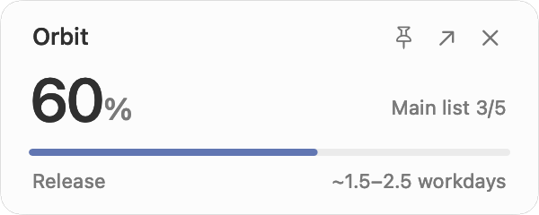
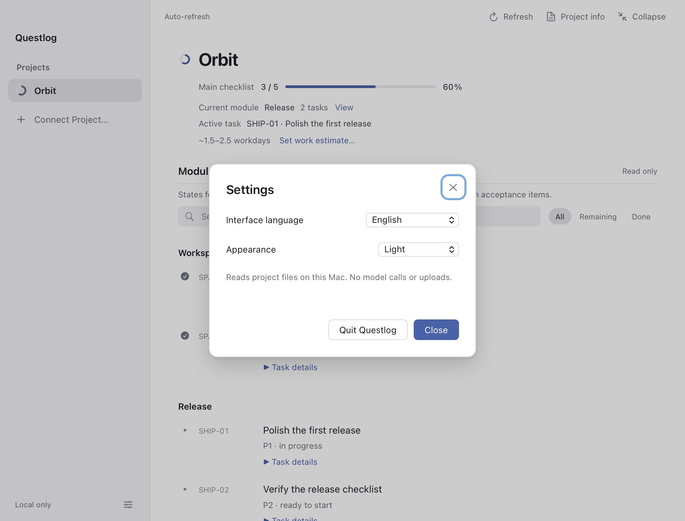
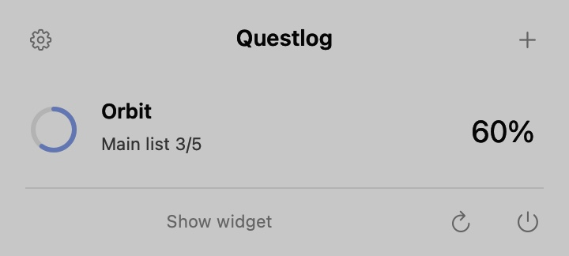

<p align="center"></p>

<h1 align="center">Questlog</h1>

<p align="center"><strong>Un compagnon discret pour suivre vos projets sur Mac.</strong><br>Vos plans Markdown locaux, dans une vue claire de ce qui avance.</p>

<p align="center">
  <a href="https://www.apple.com/macos/"></a>
  <a href="https://developer.apple.com/documentation/appkit"></a>
  <a href="https://www.python.org/downloads/macos/"></a>
  <a href="LICENSE"></a>
</p>

<p align="center"><a href="README.md">English</a> · <a href="README.zh-CN.md">简体中文</a> · <strong>Français</strong></p>
<p align="center"><a href="#premiers-pas">Premiers pas</a> · <a href="#fonctionnalités">Fonctionnalités</a> · <a href="docs/privacy.md">Confidentialité</a> · <a href="CONTRIBUTING.md">Contribuer</a></p>

<p align="center"><picture><source media="(prefers-color-scheme: dark)" srcset="docs/images/widget-dark.png"></picture></p>

Questlog lit les plans de tâches que vous conservez déjà dans vos projets. Consultez le widget natif de **300 × 120 points**, ouvrez les détails quand vous avez besoin de contexte, puis reprenez votre travail.

Aucun compte, aucune clé d’API, aucun appel à un modèle d’IA ni paquet tiers à installer pour l’exécution. Les fichiers de vos projets restent sur votre Mac.

<p align="center"><picture><source media="(prefers-color-scheme: dark)" srcset="docs/images/details-dark.jpg"></picture></p>

Captures de l’application native actuelle avec le projet fictif [Orbit](examples/orbit/tasks.md). Les aperçus suivent l’apparence claire ou sombre et ne contiennent aucune donnée personnelle.

## Fonctionnalités

- **Vue d’ensemble dans la barre des menus** — cliquez sur l’icône Questlog pour consulter les projets connectés, ouvrir leurs détails ou afficher et masquer le widget.
- **Une petite fenêtre native.** Déplacez-la où vous le souhaitez, épinglez-la sur le bureau actuel si nécessaire et ouvrez les détails à la demande.
- **Vos propres plans Markdown.** Consultez les listes à cocher, sections, étapes, plans de modules liés, titres de tâches et tableaux Task/Status.
- **Des projets locaux.** Retrouvez les dossiers de projets à partir des métadonnées de Codex ou de Claude Code, ou connectez un dossier manuellement.
- **Un avancement clairement défini.** Chaque élément de la liste principale est compté une seule fois. Les états des modules et les sous-tâches des étapes restent séparés. Sans liste de tâches, l’application affiche « — ».
- **Les détails utiles.** Recherchez et filtrez les tâches, consultez leurs lignes sources, lisez les documents du projet et affichez l’activité Git récente.
- **Des estimations que vous maîtrisez.** Saisissez une fourchette d’heures restantes et votre disponibilité quotidienne pour obtenir une fourchette de jours ouvrés.
- **L’apparence de votre choix.** Choisissez Suivre le système, Clair ou Sombre dans Réglages. La mini-fenêtre, la vue de la barre des menus et les détails changent ensemble ; le choix est conservé au redémarrage.
- **Trois langues d’interface.** English, 简体中文 et Français, avec une option pour suivre la langue du système. Le contenu des projets reste dans sa langue d’origine.
- **Un fonctionnement discret.** Le widget vérifie les métadonnées des fichiers. Le service local démarre à l’ouverture des détails et s’arrête lorsque vous revenez au widget.

<details>
<summary>Réglages d’apparence et vue de la barre des menus</summary>

<p align="center"></p>
<p align="center"></p>

</details>

## Premiers pas

### Prérequis

La première version Mac App Store est en préparation. Elle embarque son environnement et demande un accès en lecture seule aux dossiers via macOS. Consultez le [guide Xcode](docs/mac-app-store.md). Le lanceur depuis les sources reste disponible ci-dessous ; aucun téléchargement sur le store n’est encore publié.

- macOS **13 ou version ultérieure**.
- Python **3.9 ou version ultérieure**, accessible avec `python3`.
- Les **Command Line Tools** d’Apple, dont `swiftc` et `codesign`.
- Git pour cloner le code source. Node.js est facultatif et sert uniquement aux vérifications de développement.

### Compilation et installation

La distribution actuelle comprend **uniquement le code source**. Compilez Questlog sur le Mac où vous comptez l’utiliser : l’application enregistre le chemin de Python sur cette machine et reçoit une signature locale ad hoc. Aucun téléchargement portable et notarié ni paquet Homebrew n’est proposé pour le moment.

```sh
git clone https://github.com/jamezzh7/questlog.git
cd questlog
python3 build_app.py
python3 install_app.py
open /Applications/Questlog.app
```

Si les Command Line Tools ne sont pas installés, exécutez d’abord `xcode-select --install`. Pour installer l’application uniquement pour votre compte utilisateur :

```sh
python3 install_app.py --destination ~/Applications/Questlog.app
open ~/Applications/Questlog.app
```

Pour mettre Questlog à jour, quittez l’application, récupérez la dernière version du code source, puis relancez la compilation et l’installation. L’installateur conserve les réglages existants dans `~/Library/Application Support/Questlog/projects.json`. Recompilez l’application si Python change d’emplacement ou si vous passez à un autre Mac. Consultez le [guide de développement](docs/development.md) pour les autres options et le dépannage.

### Connecter votre premier projet

1. Ouvrez les détails depuis le widget, puis choisissez **Connecter un projet**.
2. Sélectionnez **Codex**, **Claude Code** ou **Saisie manuelle**.
3. Connectez un projet contenant un plan Markdown. Utilisez **Choisir une liste** pour changer de source.

Essayez [l’exemple Orbit fourni](examples/orbit/tasks.md) en connectant manuellement son dossier. Une simple liste à cocher fonctionne aussi :

```md
# Mon projet
- [x] A1 Créer l’espace de travail
- [ ] A2 Développer la première fonctionnalité
- [ ] A3 Tester et livrer
```

Cette liste affiche **1/3 terminé (33 %)**. Si votre document combine des critères de validation principaux et des sous-tâches, utilisez `primaryIds` pour sélectionner les identifiants stables des tâches principales. Consultez le [guide de configuration et des formats pris en charge](docs/configuration.md).

## Calcul de l’avancement

Le pourcentage principal correspond au **nombre d’éléments terminés de la liste principale divisé par le nombre total d’éléments**, chaque élément ayant le même poids. Il ne mesure pas l’effort de développement et ne se déduit pas des modifications du code.

Les tâches des modules conservent les états explicites du document source : en cours, livré, reporté ou en attente de validation, par exemple. Elles ne valident pas automatiquement les éléments de la liste principale. Les commits Git apparaissent dans l’activité sans modifier le pourcentage. Une estimation de durée n’est disponible que lorsque toutes les tâches principales restantes ont une estimation en heures ; elle donne une fourchette de jours ouvrés, sans garantir une date de livraison.

## Des données qui restent sur votre Mac

Questlog lit les fichiers Markdown connectés et, lorsque les détails sont ouverts, une sélection limitée de documents du projet et de métadonnées Git récentes. La découverte facultative de projets lit les métadonnées des dossiers locaux de Codex ou de Claude Code. Elle ne lit pas les conversations et n’appelle pas leurs modèles.

L’application enregistre ses propres réglages de connexion, de langue, d’apparence, de périmètre et d’estimation. Elle ne modifie ni les projets suivis ni les registres des outils. Le service de détails écoute uniquement sur `127.0.0.1`, sans collecte de statistiques d’utilisation ni serveur distant. Consultez les [informations sur la confidentialité](docs/privacy.md).

## Raccourcis

| Raccourci | Action |
| --- | --- |
| `⌘1` | Avancement des projets |
| `⌘D` | Ouvrir les détails |
| `⌘0` | Revenir au widget |
| `⌘R` | Actualiser |
| `⌘Q` | Quitter |
| `Tab` / `Shift-Tab` | Passer d’un contrôle à l’autre |
| `Escape` | Fermer un menu ou une boîte de dialogue |

Un clic droit sur le widget permet de changer de projet. Fermer la fenêtre de détails ramène au widget ; le bouton de fermeture du widget le masque. Questlog reste accessible dans la barre des menus. Utilisez le bouton d’alimentation du panneau ou `⌘Q` pour quitter.

## Développement

Swift et AppKit assurent l’interface native, la bibliothèque standard de Python lit les plans locaux, et du HTML/CSS/JavaScript sans framework alimente la vue WebKit à la demande. Aucune compilation npm ni installation de paquets Python n’est nécessaire.

```sh
python3 -m unittest discover -s tests -v
node --test tests/*.cjs
node --check public/app.js
node --check public/i18n.js
```

Consultez l’[architecture](docs/architecture.md), le [guide de développement](docs/development.md) et le [journal des modifications](CHANGELOG.md). Les guides techniques liés sont actuellement en anglais.

## Contribuer

Les rapports de bugs, améliorations de la documentation, traductions et pull requests ciblées sont les bienvenus. Lisez [CONTRIBUTING.md](CONTRIBUTING.md) avant d’entreprendre des changements importants. Pour signaler un problème de sécurité, suivez les indications de [SECURITY.md](SECURITY.md).

## Licence

[MIT](LICENSE) © 2026 jamezzh7. Les symboles système d’Apple sont soumis aux conditions d’Apple ; consultez les [mentions relatives aux éléments tiers](THIRD_PARTY_NOTICES.md).
