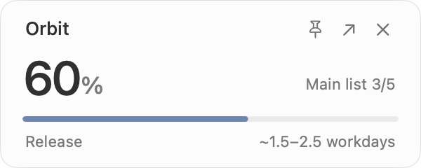
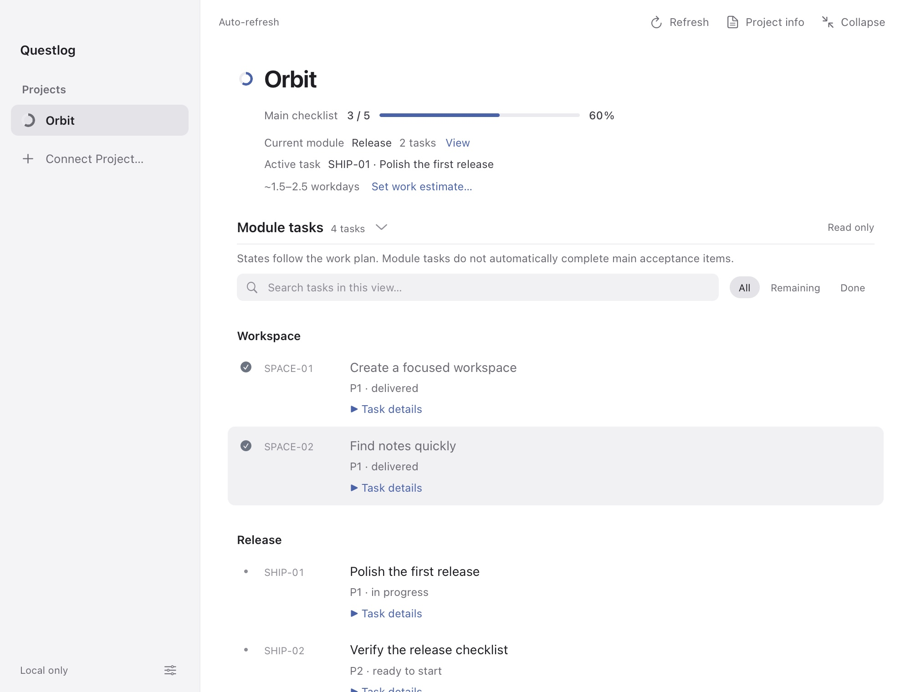

<p align="center"></p>

<h1 align="center">Questlog</h1>

<p align="center"><strong>A quiet progress companion for your Mac.</strong><br>Turn local Markdown plans into a small, readable view of what's moving.</p>

<p align="center">
  
  
  
  <a href="LICENSE"></a>
</p>

<p align="center"><strong>English</strong> · <a href="README.zh-CN.md">简体中文</a> · <a href="README.fr.md">Français</a></p>
<p align="center"><a href="#getting-started">Get started</a> · <a href="#features">Features</a> · <a href="docs/privacy.md">Privacy</a> · <a href="CONTRIBUTING.md">Contribute</a></p>

<p align="center"></p>

Questlog reads the task plans you already keep in your project. Glance at the native **300 × 120 pt** widget, open the details when you need context, then get back to building.

No account, API key, model calls, or third-party runtime packages. Your project files stay on your Mac.

<p align="center"></p>

Screenshots use the fictional [Orbit example](examples/orbit/tasks.md), with no personal project data.

## Features

- **Menu bar overview** — click the Questlog icon to compare connected projects, open a project, or show and hide the widget.
- **A small native window.** Drag it where you like, optionally pin it on the current desktop, and expand it for details.
- **Bring your own Markdown.** Read checklists, document sections, milestones, linked module plans, task headings, and Task/Status tables.
- **Connect local projects.** Discover project directories from Codex or Claude Code metadata, or select a directory manually.
- **Progress with a clear meaning.** Main checklist items count once. Module states and milestone subtasks stay separate. Missing plans show “—”.
- **Details when you need them.** Search, filter, inspect source lines, read project documents, and view recent Git activity.
- **Estimates you control.** Enter remaining hour ranges and daily availability to see a working-day range.
- **Three interface languages.** English, 简体中文, and Français, with a system-language option. Project content stays as written.
- **Quiet by default.** The widget checks file metadata; the local detail service starts only when you open details and stops when you collapse them.

## Getting started

### Requirements

The sandboxed Mac App Store target is being prepared for its first release. It embeds its runtime and requests read-only folder access through macOS. See the [Xcode build guide](docs/mac-app-store.md). The source launcher below remains available; there is no published store download yet.

- macOS **13 or later**.
- Python **3.9 or later**, available as `python3`.
- Apple **Command Line Tools**, including `swiftc` and `codesign`.
- Git to clone the source. Node.js is optional and used only for development checks.

### Build and install

The current distribution is **source only**. Build on the Mac where you will use Questlog; the app records that machine's Python path and is locally ad hoc signed. A portable, notarized download and Homebrew package are not available yet.

```sh
git clone https://github.com/jamezzh7/questlog.git
cd questlog
python3 build_app.py
python3 install_app.py
open /Applications/Questlog.app
```

If Command Line Tools are missing, run `xcode-select --install` first. For a user-only installation:

```sh
python3 install_app.py --destination ~/Applications/Questlog.app
open ~/Applications/Questlog.app
```

To update, quit Questlog, pull the latest source, then build and install again. The installer preserves existing settings in `~/Library/Application Support/Questlog/projects.json`. Rebuild after changing Python's location or moving to another Mac. More options and troubleshooting: [development guide](docs/development.md).

### Connect your first project

1. Open details from the widget, then choose **Connect Project**.
2. Select **Codex**, **Claude Code**, or **Manual**.
3. Choose a project with a Markdown plan. Use **Choose task list** to change the source.

Try [the included Orbit example](examples/orbit/tasks.md) by connecting its directory manually. A plain checklist works too:

```md
# My project
- [x] A1 Set up the workspace
- [ ] A2 Build the first feature
- [ ] A3 Test and ship
```

This checklist shows **1/3 complete (33%)**. For mixed acceptance lists and subtasks, select stable main task IDs with `primaryIds`. See [configuration and supported plans](docs/configuration.md).

## How progress works

The headline percentage is **completed main checklist items ÷ all main checklist items**, with equal weight per item. It is not a measure of engineering effort or a prediction based on code changes.

Module tasks preserve explicit source states such as in progress, delivered, deferred, or awaiting acceptance. They do not silently check off parent acceptance items. Git commits appear as activity, without changing the percentage. Completion dates appear only when all remaining main items have hour estimates; the result is a working-day range, not a delivery guarantee.

## Local by design

Questlog reads connected Markdown files and, while details are open, a bounded selection of project documents and recent Git metadata. Optional discovery reads local project-directory metadata from Codex or Claude Code. It does not read conversation transcripts or call their models.

The app writes its own connection, language, scope, and estimate settings. It does not edit tracked projects or tool registries. The detail service binds to `127.0.0.1`, and the app includes no analytics or remote backend. [Read the privacy details](docs/privacy.md).

## Shortcuts

| Shortcut | Action |
| --- | --- |
| `⌘1` | All project progress |
| `⌘D` | Open details |
| `⌘0` | Return to the widget |
| `⌘R` | Refresh |
| `⌘Q` | Quit |
| `Tab` / `Shift-Tab` | Move between controls |
| `Escape` | Close a menu or dialog |

Right-click the widget to switch projects. Closing the detail window returns to the widget; the widget's close button hides it. Questlog stays available in the menu bar. Use the popover’s power button or `⌘Q` to quit.

## Development

Swift/AppKit provides the native shell, Python's standard library reads local plans, and plain HTML/CSS/JavaScript powers the on-demand WebKit detail view. There is no npm build or Python package installation.

```sh
python3 -m unittest discover -s tests -v
node --test tests/test_i18n.cjs
node --check public/app.js
node --check public/i18n.js
```

See the [architecture](docs/architecture.md), [development guide](docs/development.md), and [changelog](CHANGELOG.md).

## Contributing

Bug reports, documentation improvements, translations, and focused pull requests are welcome. Please read [CONTRIBUTING.md](CONTRIBUTING.md) before making larger changes. Report security concerns through the channels described in [SECURITY.md](SECURITY.md).

## License

[MIT](LICENSE) © 2026 jamezzh7. Apple system symbols are subject to Apple's terms; see [third-party notices](THIRD_PARTY_NOTICES.md).
