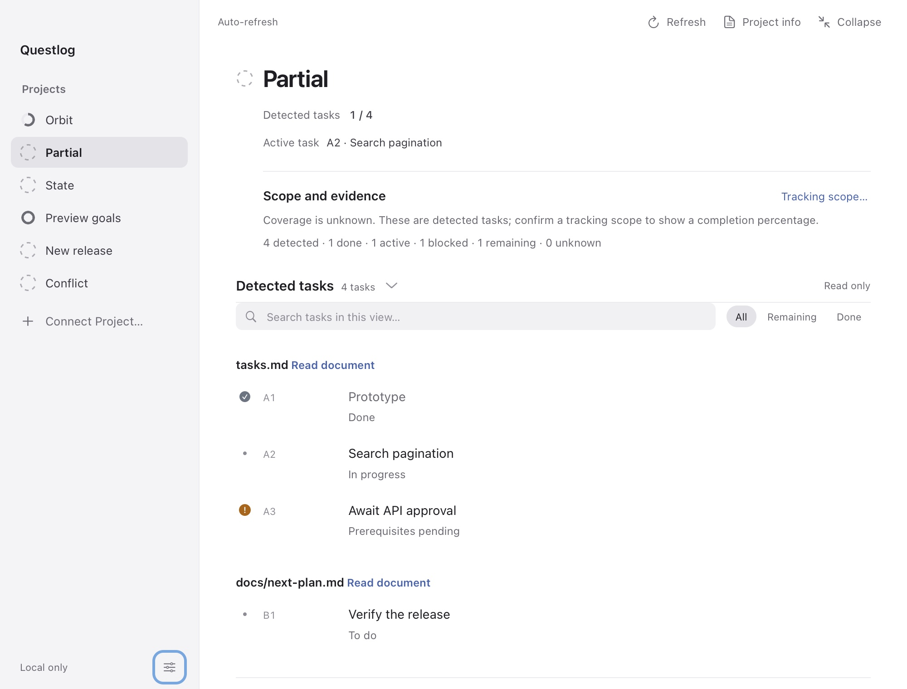
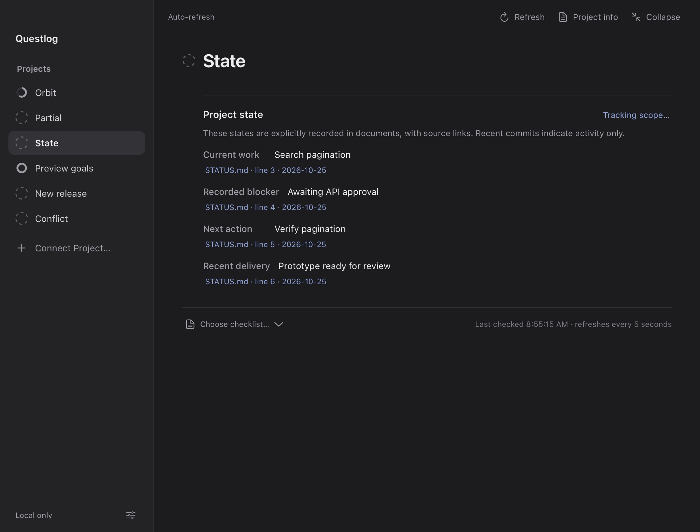

# Project state and tracking scope

Questlog can follow projects without a complete task plan. It separates a defined completion fraction from detected work and document evidence.

| Mode | What appears |
| --- | --- |
| Defined scope | A percentage for a chosen checklist, explicit main IDs, or your own goals. The source or scope name stays visible. |
| Detected tasks | Done, active, blocked, remaining and unknown counts. Coverage is unknown, so no percentage is shown. |
| Project state | Explicit current work, blockers, next actions and deliveries from project documents, with file, line and update date. |
| More information needed | An honest unknown state, project notes and a way to define goals. |

## Examples





These native captures use fictional local projects.

## Confirm a scope

Open a project's details and choose **Tracking scope…**. Select **Current checklist as a defined scope**, give it a name such as “Release 0.2 acceptance”, and save. This percentage describes that checklist, rather than the entire product. To track a different file or module plan, choose the source first.

Existing manually selected sources and explicitly configured main IDs retain their defined scope. An automatic source change does not reuse another file's main IDs or work estimates. Changes in the number of measured items are announced when the detail view refreshes.

## Lightweight goals

Choose **My lightweight goals** and enter one goal per line. Prefix completed goals with `[x]` and remaining goals with `[ ]`:

```text
[x] Build the prototype
[ ] Verify the first release
```

Goals, completion marks and their scope name stay in Questlog's own configuration. They do not create or modify a project's task document. Edit completion here whenever needed. Up to 20 goals are supported; the task list remains a read-only view. Switching back to automatic tracking keeps the saved goals. Goal work estimates are independent of source checklist estimates.

## Detection and evidence

- Automatic discovery prefers a document marked as current or a task plan explicitly linked from README or handoff documentation over a conventional filename alone. A modification date alone does not make a plan authoritative.
- Installation instructions in README, fenced examples, comments, example directories and historical sections do not count as current project work. Plans explicitly marked as an old completed release or superseded are not automatically selected.
- Without a defined scope, up to four eligible task sources are combined. Matching explicit IDs and titles are counted once. Conflicting states become unknown, with a source warning. Linked module acceptance subchecks stay separate from main acceptance items.
- With no task structure, at most four known project documents provide explicit fields such as `Current:`, `Blocker:`, `Next:` and `Recent delivery:`. Unknown, missing and conflicting information stays visible. Claims are displayed as document evidence; they are not verified product completion.
- Git commit metadata is activity context in details only. Commit volume, file counts and inactivity are never converted to completion percentages or assumed blockers.

The native widget keeps its metadata checks and one-shot summaries. Automatic discovery is reconsidered about every 30 seconds; changed watched sources refresh sooner. Document state uses bounded local reads when there is no task plan. There is no background Git scan, model call or remote service.

## Configuration

`trackingScope.kind` is `auto`, `checklist` or `goals`. Checklist scopes store a `source` relative to the project and a `title`. Goal scopes store stable item IDs, titles and done flags. `savedGoals`, `goalEstimates` and `goalHoursPerDay` retain app-owned goals and their estimates separately from source plans. Use the interface to manage these settings.

The API preserves `overall` as the selected checklist's raw fraction for compatibility. Consumers must check `tracking.mode == "measured"` before presenting it as a completion percentage. `tracking.counts`, `signals`, `conflicts` and `coverage` describe the other modes.
